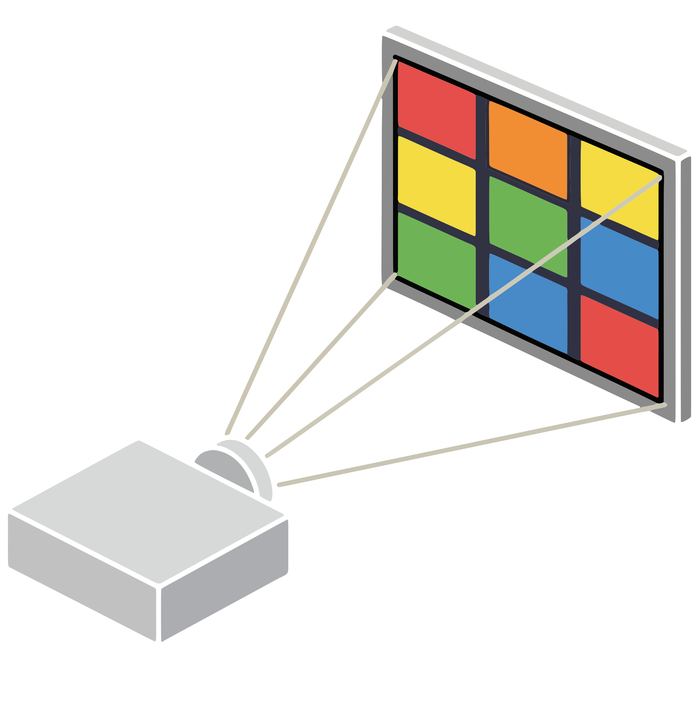

# MAPout

  

<a href="https://jvtonehammer.gumroad.com/l/mapout_hda"><strong>Get it on Gumroad →</strong></a> <a href="https://jvtools.dev/" style="font-size:0.9em;">More Houdini tools at jvtools.dev</a>

Welcome! **MAPout** (v1.0) is projection mapping inside Houdini. It puts a Copernicus network on a projector and maps it onto a real surface: a perspective corner pin, a mesh warp for surfaces that are not flat, masks, and shapes drawn straight onto the projection, each with its own UV space in the COP network.

Projection-mapping tools such as MadMapper and HeavyM sit between your content and the projector. MAPout does the same job without leaving Houdini: the content is a Copernicus network, the shapes are ordinary SOPs, and the playbar drives it.

MAPout is two nodes. A **MAPout Setup** holds the mapping and the shapes and builds the COP network for you; a **MAPout Output** owns the projector window. One button lays the whole chain out.

## Why it exists

A projector rarely hits a wall square-on, and almost never hits a box, a stage or a curtain the way the content was drawn. Correcting that needs a layer between the image and the projector, and editing that layer needs you to look at the wall rather than at a viewport.

So MAPout draws the projector window itself, warps the image there in a shader, and puts its editing tools on the projection: the pointer is on the wall, and you drag corners and draw shapes where they belong. The COP network stays a clean rectangle at the resolution you picked, and never learns a projector exists.

## What it does

- **Corner pin.** Four corners correct keystone, an off-centre projector and wall tilt. On a flat wall four corners are exact, not an approximation.
- **Mesh warp.** A lattice of control points inside the pin, for curtains, corners and curved walls.
- **Rotation.** Turn the whole image about a pinned corner or its centre.
- **Shapes drawn on the projection.** Rectangles, ellipses and polygons with Bezier points, drawn and edited on the wall, with snapping so faces that meet share their corners.
- **A COP row per shape.** Sync Shapes to COPs gives every shape its own place in the COP network, with its own UV: a four-corner face gets a perspective-correct UV from its corners.
- **Masks.** A masked shape is black on the wall whatever the COPs do.
- **More than one projector.** One Setup and Output per projector on a shared COP network, each showing its region and blending the overlap.
- **Mapping files.** Save the mapping to JSON and load it into another scene.
- **It follows the playbar.** Nothing here runs its own clock, so a COP feedback simulation steps exactly when your scene steps.

## What it does not do

- It **does not record or render to file.** It is an output window, not a ROP.
- It **does not play media or run cues.** Copernicus, CHOPs and the playbar are that half.
- It **does not map curved surfaces exactly.** The mesh warp bends the image to follow a curtain or a curved wall by eye; there is no camera-based auto-calibration.
- It **does not warp Houdini's 3D viewport.** Anything that has to reach the wall goes through the COP network.

!!!info Only need a clean output window?
[COPout](../copout/README.md) puts a Copernicus network on a projector or second screen with no mapping layer: fit, offset and zoom, and nothing to set up.
!!!

## Requirements

- **Houdini 22.0+**, Indie or Apprentice — it ships as `.hdalc`
- **Windows** — the only platform it has been tested on
- **SideFX Labs** for the coloured UV check (optional; without Labs, Show UV Check falls back to a plain checkerboard)

## Pages

- [Getting started](getting-started.md)
- [Using MAPout](using.md)
- [Parameter reference](reference/parameters.md)
- [Changelog](reference/changelog.md)
- [License](reference/license.md)
