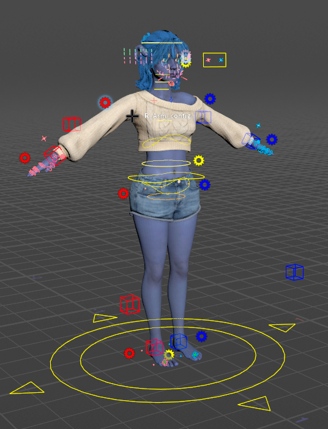
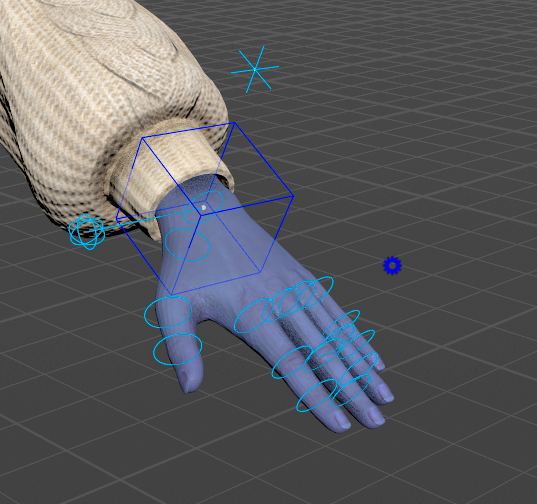
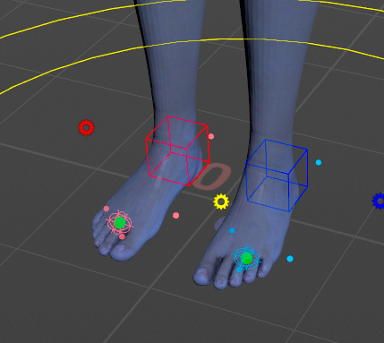
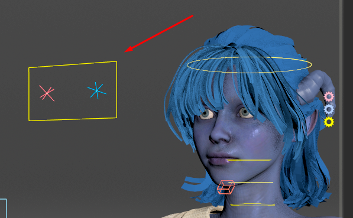

# The Controls

This page names every control the rig draws, what it moves, and which gear setting shows the ones that are hidden by default.

**Hover any control to see its name.** That name is the one the HUD, the Character Picker and the Animation Editor use.

## Colours

* **Blue** is the character's left side (names starting `L_`), **red** the right side (`R_`), **yellow** the centre. With the character facing you, the blue side is on your right.
* Secondary controls use a lighter shade of their side's colour. The detail-level crosses and boxes along the limbs are paler still.
* A few controls have colours of their own: the light-green crosses that shape the spine and neck, the orange **Pelvis** ring, the orange-red jaw box, and the green spheres at the base of the toes.
* The face sliders take the colour of their face region. The gears follow the side colours, except the two face gears: **Face** is pink and **Face Blendshapes** is pale blue.

## Detail levels

Every body control belongs to detail level 1, 2 or 3: the main controls, the secondary ones, and fine detail. The **LOD 1**, **LOD 2** and **LOD 3** buttons on each gear show and hide one level at a time. See [Gears](gears.md#the-buttons-every-body-gear-has).

The tables below give each control's level.

## Root

| What you see | Name | What it does | Level |
| --- | --- | --- | --- |
| Yellow disk on the ground | `C_main` | Moves and turns the whole character. | 1 |
| Yellow circle on the ground | `C_layout` | A second root control under `C_main`. It also moves the whole character. | 1 |

## Spine and hips

The spine is a spline: you move its two ends and it bends between them, the way SideFX's [Spine component](https://www.sidefx.com/docs/houdini/character/kinefx/rig_components/spine.html) works.

| What you see | Name | What it does | Level |
| --- | --- | --- | --- |
| Large flat yellow loop around the hips | `C_cog_ctrl` | Centre of gravity. Moves and turns the hips and upper body together. The IK hands and feet stay where they are. | 1 |
| Yellow loop at the hips | `C_pelvis_ctrl` | The bottom end of the spine. | 1 |
| Yellow loop at the chest | `C_chest_ctrl` | The top end of the spine. The spine bends to follow it. | 1 |
| Pale yellow circles along the spine | `C_spineMid_ctrl`, `C_spineEnd_ctrl` | Move and turn the middle and top of the spine on top of the curve. | 2 |
| Orange circle | `Pelvis` | Rotates the pelvis bone, the one the thighs hang from, without moving the spine. | 2 |
| Light-green crosses | `C_pelvisCv_ctrl`, `C_chestCv_ctrl` | Shape the curve near each end. | 3 |

The spine gear's **stretch** setting lets the spine lengthen to follow the chest control (see [Gears](gears.md#spine-gear)).

## Neck, head and jaw

The neck is a spline like the spine; see SideFX's [Neck Head component](https://www.sidefx.com/docs/houdini/character/kinefx/rig_components/neckhead.html).

| What you see | Name | What it does | Level |
| --- | --- | --- | --- |
| Yellow circle at the base of the neck | `C_neckRoot_ctrl` | The bottom end of the neck. | 1 |
| Yellow circle around the head | `C_head_ctrl` | Turns the head. Turning the head also drives the head-turn morphs (see [Face Tools](../using/face-tools.md#sliders-and-the-face-board)). | 1 |
| Pale yellow circle mid-neck | `C_neckMid_ctrl` | A secondary control for the middle of the neck. | 2 |
| Pale yellow circle on the head | `C_headMain_ctrl` | A second head control on top of `C_head_ctrl`. | 2 |
| Light-green crosses | `C_neckRootcv_ctrl`, `C_headCv_ctrl` | Shape the neck curve. | 3 |
| Orange-red box at the jaw | `JawRoot` | The jaw bone. Rotating it opens the mouth. | 1 |

To open the mouth by curve, see the Jaw Open note on [Face Tools](../using/face-tools.md#sliders-and-the-face-board).

## Arms

The arms start in IK: you move the hand and the arm follows. The arm's gear switches it to FK, where you rotate it joint by joint. Only one of the two sets is drawn at a time (see [Gears](gears.md#arm-gears)).

In IK, the default:

| What you see | Name | What it does | Level |
| --- | --- | --- | --- |
| Box at the wrist | `L_ArmTarget_ik`, `R_ArmTarget_ik` | The IK hand. Move and rotate it, and the arm follows. | 1 |
| Box beside the elbow | `L_ArmPolevec_ik`, `R_ArmPolevec_ik` | Points the elbow. | 1 |
| Cross at the shoulder | `L_ArmClav_fk`, `R_ArmClav_fk` | The clavicle. | 1 |
| Cross near the hand | `L_ArmClavTarget_ctrl`, `R_ArmClavTarget_ctrl` | The clavicle's target. The shoulder follows it by the gear's **AutoClav** amount. | 2 |

In FK:

| What you see | Name | What it does | Level |
| --- | --- | --- | --- |
| Rings on the arm | `L_Clavicle_fk`, `L_Upperarm_fk`, `L_Forearm_fk`, `L_Hand_fk` (and the `R_` set) | Rotate the arm joint by joint. | 1 |

At detail level 3, pale crosses and boxes appear along the arms and legs. They belong to the limb's twist setup, and you rarely need them. To rotate the twist bones themselves, turn on **twistControls** on the arm's gear.

## Hands

| What you see | Name | What it does | Level |
| --- | --- | --- | --- |
| Ring at the wrist | `L_Hand`, `R_Hand` | Rotates the hand at the wrist, on top of the IK box. | 2 |
| Ball on a short line beside the hand | `L_Hand_selector`, `R_Hand_selector` | Click it to select the hand ring and all fifteen finger rings at once. | 2 |
| Rings on each finger | `L_Thumb1` … `L_Pinky3` (three per finger, and the `R_` set) | Rotate the finger joints (FK). | 2 |

The Character Picker's **Hands** tab selects the same controls (see [Animating](../using/animating.md#the-character-picker)), and the hand poses in the Animation Catalog are keyed on these finger rings.

## Legs and feet

The legs work like the arms: IK by default, FK through the leg's gear. The feet are reverse feet: the foot turns about pivots at the heel, the ball, the toe tip and each side.

| What you see | Name | What it does | Level |
| --- | --- | --- | --- |
| Box at the ankle | `L_FootAnkle_ik`, `R_FootAnkle_ik` | The IK foot. Move it and the leg follows. | 1 |
| Box in front of the knee | `L_LegPolevec_ik`, `R_LegPolevec_ik` | Points the knee. | 1 |
| Rings on the leg (FK only) | `L_Thigh_fk`, `L_Calf_fk`, `L_Foot_fk` (and the `R_` set) | Rotate the leg joint by joint. | 1 |
| Small spheres around the foot | `L_footHeel_ctrl`, `L_footToe_ctrl`, `L_footTiltA_ctrl`, `L_footTiltB_ctrl` | Pivots. Rotating one turns the whole foot about the heel, the toe tip, or one side. | 2 |
| Wire ball at the ball of the foot | `L_FootBall_ctrl` | Pivots the whole foot at the ball of the foot. | 2 |
| Cross at the ball of the foot | `L_FootBallRot_ctrl` | Bends the toes up or down at the ball, without moving the foot. | 2 |
| Green sphere at the toes | `L_ToeBase` | The toe joint: all toes together. | 3 |

The last four rows give the `L_` names, and there is an `R_` set as well.

The foot's gear has **roll** and **tilt** sliders that drive the pivots for you, and **toeControls** for a control on each toe (see [Gears](gears.md#foot-gears)).

## Eyes and Look At

| What you see | Name | What it does | Level |
| --- | --- | --- | --- |
| Yellow frame in front of the eyes | `MainTarget` | Moves both eye targets together. | 1 |
| A cross per eye, inside the frame | `L_EyeTarget`, `R_EyeTarget` | Where each eye looks. | 2 |
| Yellow three-ring control about a metre in front of the face | `C_look_ctrl` | The Look At target. The eyes, head and chest turn toward it by the Eyes gear's settings. | — |

See [Auto Animation](../using/auto-animation.md#look-at) for how the two targets work together, and [Gears](gears.md#eyes-gear) for the settings.

## The face

* **Sliders on the face** (coloured balls on short lines) and a panel of extra sliders beside the head, left of it by default. The Face gear picks which sliders show and where the panel sits.
* The **face board**, when the Face gear's **boxlayout** is on.
* The **face sprite** at the bottom left of the viewport, which opens the list of slider sets.
* The **Face Puppet pad** and its two sprites, above the face sprite.
* **Three gears beside the head**, top to bottom: **Face** (pink), **Face Blendshapes** (pale blue) and **Eyes** (yellow). See [Gears](gears.md).

All of these are explained on [Face Tools](../using/face-tools.md).

## Hidden until you ask

These controls are hidden by default to keep the viewport clear. A gear setting shows each group.

| Controls | Shown by |
| --- | --- |
| The arm's FK rings (in IK) or its IK box and pole (in FK) | The arm gear's IK/FK switch |
| The leg's FK rings (in IK) or its IK box and pole (in FK) | The leg gear's IK/FK switch |
| A control on each toe | **toeControls** on the foot gear |
| Rings on the arm's and leg's twist bones | **twistControls** on the arm or leg gear |
| Rings on the two breast bones | **breastControls** on the spine gear |
| Rings on the two ribcage bones (the ones Auto Breathe moves) | **ribcageControls** on the spine gear |
| The lower teeth and tongue | **mouthControls** on the Face gear |
| A control on every joint beyond the standard Character Creator skeleton, such as hair bones | **extraControls** on the root gear (only on characters that have such joints) |
