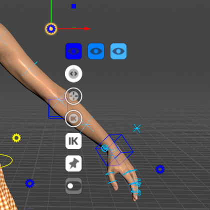
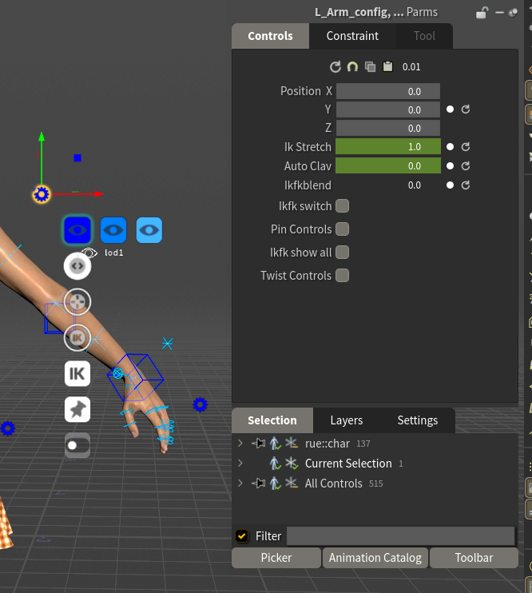

# Gears

A gear is a control that holds settings instead of moving a joint. Each body part has one beside it, and there are three beside the head for the face and eyes.

This page lists every gear and every setting on it, under the name the HUD shows.

## How a gear works

**Click a gear** to see its settings as a stack of small icons beside it. They show only while that gear is the selected control.

On a body gear the three blue eye icons in a row are the LOD buttons, the round dials are sliders, the **IK** square is the IK/FK switch, the pushpin is **pinControls** and the switch icons are toggles. Hover an icon to see its name.

Press **G** to see them all at once: the HUD's **Controls** tab lists every setting of the selected gear with its value. It shows each name spaced out and capitalised, so `IkStretch` reads **Ik Stretch**, `AutoClav` **Auto Clav** and `ikfk_show_all` **Ikfk show all**. The tables below use the names.

How to use each kind:

* **Toggle**: click to turn it on or off.
* **Slider**: click and drag to change the value. Hold **Shift** to change it more slowly, **Ctrl** to change it in whole steps, **Ctrl+Shift** to change it faster. You can also type a value in the HUD.
* **Menu**: click to open its list.
* **Eye icons**: the **LOD** buttons (see below).

**Keyable or setting.** Some gear values are keyable channels, keyed like any other control: they can change over the shot, and they live on the animation layers. The rest are settings: one value for the whole shot, never keyed. **Clear Body Keys** and **Clear Face Keys** don't touch settings. The tables mark which is which.

**Moving a gear.** A gear is drawn at a fixed offset from its body part. Drag it to move it out of the way. The HUD lists its place as `position`.

SideFX's documentation: [Gear menu](https://www.sidefx.com/docs/houdini/character/kinefx/autorigbuilder.html#gearmenu).

## The buttons every body gear has

* **LOD 1**, **LOD 2** and **LOD 3** (eye icons, `lod1` `lod2` `lod3` in the HUD) are independent show/hide toggles, one per detail level, not a level of detail you step through. On the root gear they act on the whole rig; on any other gear, only on that body part. Use them to clear controls out of the way while you work on one area. (Detail levels: see [The Controls](controls.md#detail-levels).)
* **pinControls** lists that gear's controls in the Animation Editor, so their curves are in view while you key. It does not lock the pose. Pinning another gear replaces the list rather than adding to it. Each table below says what that gear's pin lists.

## Root gear

Yellow, on the ground between the feet.

| Name in the HUD | Kind | Range (default) | Keyable | What it does |
| --- | --- | --- | --- | --- |
| `lod1` `lod2` `lod3` | Buttons | — | — | Show or hide a detail level on the whole rig. |
| `extraControls` | Toggle | off | No | Shows a control on every joint beyond the standard Character Creator skeleton, such as hair bones. Only on characters that have such joints. The Character Picker gets an **Extras** tab for them. |

## Spine gear

Yellow, beside the waist. It also covers the neck and head, which have no gear of their own.

| Name in the HUD | Kind | Range (default) | Keyable | What it does |
| --- | --- | --- | --- | --- |
| `stretch` | Slider | 0 to 1 (0) | Yes | Lets the spine lengthen to follow the chest control. At 0 the spine keeps its length; at 1 it stretches to wherever you put the chest control. |
| `breastControls` | Toggle | off | No | Shows rings on the two breast bones. |
| `ribcageControls` | Toggle | off | No | Shows rings on the two ribcage bones (`L_RibsTwist`, `R_RibsTwist`), the ones Auto Breathe moves. |
| `pinControls` | Toggle | off | No | Lists the spine, neck, head, pelvis, jaw, breast and ribcage controls in the Animation Editor. |
| `lod1` `lod2` `lod3` | Buttons | — | — | Show or hide a detail level of the spine, neck and head controls. |

## Arm gears

One per arm, blue for the left and red for the right, beside the upper arm.

| Name in the HUD | Kind | Range (default) | Keyable | What it does |
| --- | --- | --- | --- | --- |
| `ikfk_switch` | IK/FK switch | IK | Yes | Switches the arm between IK and FK. Before switching, it moves the other mode's controls onto the current pose, so the arm doesn't jump, then sets `ikfkblend` to 0 (IK) or 1 (FK). **Shift+click** switches and keys it at the current frame. |
| `ikfkblend` | Slider | 0 to 1 (0) | Yes | 0 is IK (the hand follows its IK box), 1 is FK (the arm follows its FK rings), and in between is a mix of the two poses. Dragging it doesn't line the controls up first, so the arm moves between the IK pose and the FK pose; for a clean change use the switch. |
| `IkStretch` | Slider | 0 to 1 (0) | Yes | Lets the arm lengthen when you pull the IK box beyond its reach. At 0 the arm stops at full length; at 1 it stretches all the way to the box. It does nothing until the arm is straight. |
| `AutoClav` | Slider | 0 to 1 (0.6) | Yes | How much the shoulder follows the IK hand. At 0 the clavicle stays where you put it; at 1 it follows fully. |
| `twistControls` | Toggle | off | No | Shows rings on the arm's four twist bones, two in the upper arm and two in the forearm, so you can rotate them by hand. |
| `pinControls` | Toggle | off | No | Lists the arm's IK and FK controls, and its `ikfkblend` and `AutoClav` channels, in the Animation Editor. |
| `lod1` `lod2` `lod3` | Buttons | — | — | Show or hide a detail level of the arm. |
| `ikfk_show_all` | Not drawn | off | No | By default only the active mode's controls are drawn: in IK the FK rings are hidden, in FK the IK box and pole are. This setting shows both sets at once. It has no icon on the gear: turn it on in the HUD, where it reads **Ikfk show all**. |

## Hand gears

One per hand, beside it.

| Name in the HUD | Kind | Range (default) | Keyable | What it does |
| --- | --- | --- | --- | --- |
| `pinControls` | Toggle | off | No | Lists the fifteen finger controls in the Animation Editor. |
| `lod1` `lod2` `lod3` | Buttons | — | — | Show or hide a detail level of the hand. |

The fingers have no IK; you pose them with their rings, the Character Picker's **Hands** tab or the hand poses in the Animation Catalog.

## Leg gears

One per leg, beside the thigh. Same as the arm gears, without the clavicle.

| Name in the HUD | Kind | Range (default) | Keyable | What it does |
| --- | --- | --- | --- | --- |
| `ikfk_switch` | IK/FK switch | IK | Yes | As on the arm: switches between IK and FK without a jump. **Shift+click** also keys it. |
| `ikfkblend` | Slider | 0 to 1 (0) | Yes | 0 is IK (the foot follows its IK box), 1 is FK. |
| `IkStretch` | Slider | 0 to 1 (0) | Yes | Lets the leg lengthen when you pull the foot box beyond its reach. At 0 the leg stops at full length; at 1 it stretches to the box. |
| `twistControls` | Toggle | off | No | Shows rings on the leg's four twist bones, two in the thigh and two in the calf. |
| `pinControls` | Toggle | off | No | Lists the leg's IK and FK controls and its `ikfkblend` channel in the Animation Editor. |
| `lod1` `lod2` `lod3` | Buttons | — | — | Show or hide a detail level of the leg. |
| `ikfk_show_all` | Not drawn | off | No | Shows the IK and FK controls at the same time, as on the arm. Turn it on in the HUD. |

## Foot gears

One per foot, beside it. Roll and tilt drive the foot's pivots for you, so you can roll a step with one slider instead of rotating three controls.

| Name in the HUD | Kind | Range (default) | Keyable | What it does |
| --- | --- | --- | --- | --- |
| `roll` | Slider | -10 to 10 (0) | Yes | Positive rocks the foot back onto the heel and lifts the toes. Negative rolls it forward: first the heel lifts and the foot pivots over the ball, then further on it rises onto the tips of the toes. |
| `tilt` | Slider | -10 to 10 (0) | Yes | Positive rolls the foot onto its outer edge (the little-toe side), negative onto its inner edge (the big-toe side). The same on both feet. |
| `toeControls` | Toggle | off | No | Shows a control on each toe. |
| `pinControls` | Toggle | off | No | Lists the foot's IK box and its pivot controls in the Animation Editor. |
| `lod1` `lod2` `lod3` | Buttons | — | — | Show or hide a detail level of the foot. |

## Eyes gear

Yellow, the lowest of the three gears beside the head. It holds the Look At settings, which work like iClone's Look At panel, with 0 to 1 in place of iClone's 0 to 100. `headWeight`, `bodyWeight`, `angleLimit` and the lean sliders do nothing while `lookAt` is 0. `browFollow` works whenever the eyes look up or down, Look At or not.

| Name in the HUD | Kind | Range (default) | Keyable | What it does |
| --- | --- | --- | --- | --- |
| `lookAt` | Slider | 0 to 1 (0) | Yes | Blends the eyes from their own crosses onto the yellow three-ring Look At target. See [Auto Animation](../using/auto-animation.md#look-at). |
| `headWeight` | Slider | 0 to 1 (0.6) | Yes | How much the head turns toward the target, out of what the chest leaves. |
| `bodyWeight` | Slider | 0 to 1 (0.2) | Yes | How much the chest turns toward the target. |
| `angleLimit` | Slider | 0 to 180 (70) | Yes | The most, in degrees, that the chest and head turn. The eyes do the rest. |
| `leanX` `leanY` `leanZ` | Sliders | 0 to 1 (1) | Yes | Scale the chest's turn on each of the character's axes: X leans forward and back, Y turns, Z tilts to the side. |
| `browFollow` | Slider | 0 to 1 (0) | Yes | Adds Character Creator's eye-to-brow link: the brows rise as the eyes look up and drop as they look down. |
| `lod1` `lod2` `lod3` | Buttons | — | — | Show or hide the eye targets by detail level. |

## Face gear

Pink, the top gear beside the head. None of its settings is keyable.

| Name in the HUD | Kind | Range (default) | Keyable | What it does |
| --- | --- | --- | --- | --- |
| `face_set` | Menu | Curated | No | Which sliders the face shows. **None**, **Curated** (the essentials), or one region of the face: **Brows**, **Lids**, **Eyes**, **Nose**, **Cheeks**, **Corners**, **UpperLip**, **LowerLip**, **Lips**, **Jaw**, **Visemes**, **Tongue**, **Head**, **Other**, plus **Correctives** on characters that have corrective shapes. A region keeps its curated sliders on the face and gives every other shape in the region a slider of its own in the panel beside the head. The face sprite at the bottom left of the viewport opens the same list. |
| `off_face_sliders` | Menu | Left of Head | No | Where that panel sits: **Below Chin**, **Above Head**, **Left of Head**, **Right of Head**, or **None**, which hides it. Left and right are as you look at the face. The panel moves with the head. |
| `boxlayout` | Toggle | off | No | Shows the sliders as the flat **face board** and hides the ones on the face. See [Face Tools](../using/face-tools.md#sliders-and-the-face-board). |
| `mouthControls` | Toggle | off | No | Shows the lower teeth and tongue controls. |
| `slidersFollowClip` | Toggle | off | No | Moves the sliders on the face with the clip: each shows the clip's value plus your offset. Off, they show your offset only. The face board's sliders always follow the clip. It changes where the sliders are drawn, not the face. |
| `control_size` | Slider | 0 to 1 (0.5) | No | The length of the face sliders. 1 is full length; 0 is 70 percent shorter, each about its own centre. |
| `slider_alpha` | Slider | 0 to 1 (0.75) | No | How opaque the slider lines on the face are. |
| `pinControls` | Toggle | off | No | Lists every face slider in the Animation Editor. |
| `puppet_profile` | Menu | Off | No | The Face Puppet profile. The pad's menu sprite shows the same list, and **Off** hides the pad. See [Face Tools](../using/face-tools.md#face-puppet). |
| `puppet_strength` | Slider | 0 to 2 (1) | No | How far the Face Puppet pad pushes the face. 1 is the profile's full shapes. |
| `puppet_solo`, `puppet_recording`, `puppet_blink` | Not drawn | — | No | Set for you by the pad's **Solo** sprite and by a Face Puppet take while it records. Leave them alone. |

## Face Blendshapes gear

Pale blue, the middle gear beside the head. It has a keyable channel for every Character Creator face shape on the character, named after the shape (`Brow_Raise_Inner_L`, `Jaw_Open`, `V_Wide` and so on), each 0 by default.

It draws no icons. Select the gear and its channels are listed in the HUD (**G**) and in the Animation Editor.

**Each channel adds onto its face shape.** A face shape's final value is the sum of three things:

1. its `face_<shape>` channel: the clip, and what Face Key Muscle, Face Puppet and Auto Blink key,
2. its slider on the face, if it has one,
3. its channel on this gear.

That's why a shape can move with its slider at zero, and why a clip keeps playing under a slider or a gear value: they add, they don't replace.

Catalog expressions are written on this gear's channels. Because the channels belong to this gear, select it before you apply an expression with controls selected, or before **Add to New Layer**. It's also why an expression adds onto the clip's face instead of replacing it. See [Animating](../using/animating.md#the-animation-catalog).

Use this gear when you want a face shape by number: select the gear, press **G**, and type the value or Alt+click to key it.
