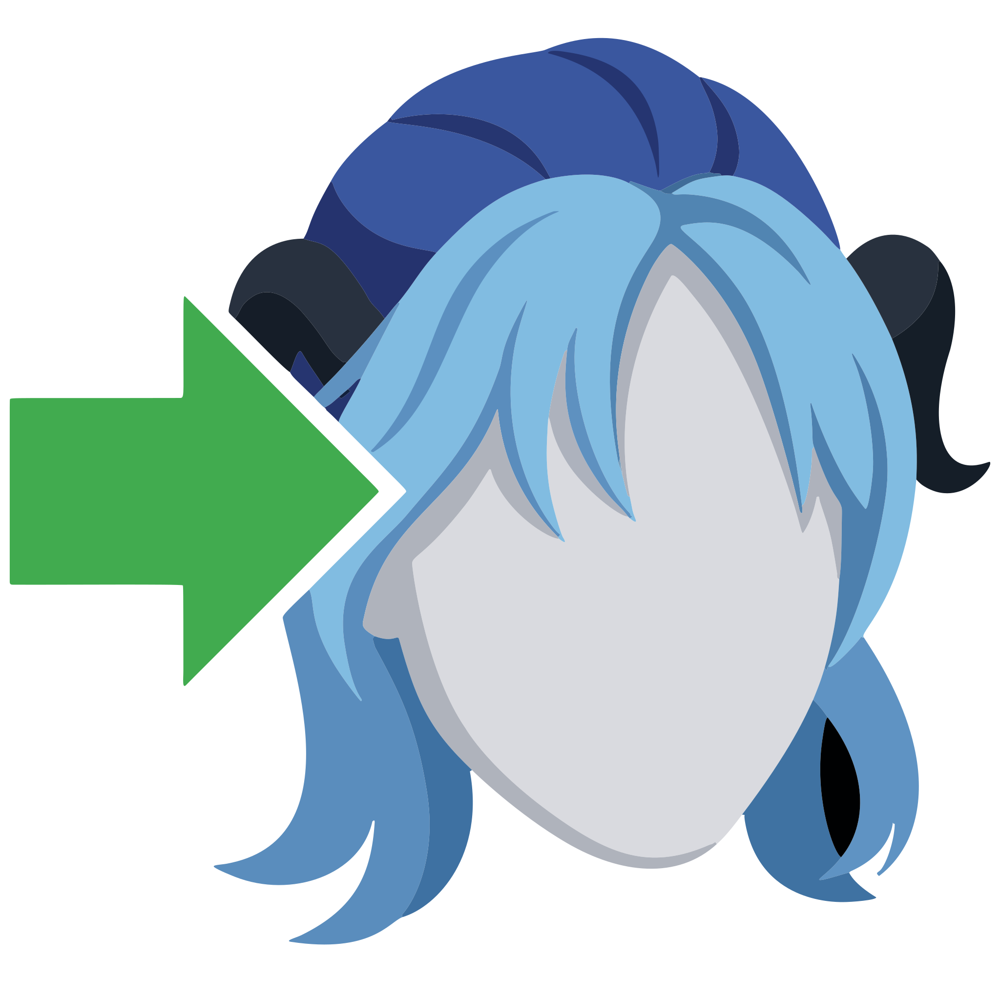

# Reallusion Rigger for Houdini

  

<a href="https://jvtonehammer.gumroad.com/l/reallusionimporterforhoudini"><strong>Get it on Gumroad →</strong></a> <a href="https://jvtools.dev/" style="font-size:0.9em;">More Houdini tools at jvtools.dev</a>

**Reallusion Rigger** (v1.1) turns a Character Creator 5 or iClone 8 character into a fully shaded character in Houdini's Solaris environment, and builds it an APEX animation rig — body and face — that you animate right in the viewport.

Export your character from Character Creator as **USD** (fast and light, the recommended default) or **FBX**, point this tool at it, and click one button. It rebuilds your character in Solaris with proper Karma MaterialX materials for skin, eyes, teeth, hair and clothing, gathers every meaningful look control onto a single panel, and then builds a rig node below it. Press **Animate** on that node and you're posing and keying the character in Houdini's APEX animate state, face included, with the character's own exported animation already on it.

Built for Character Creator 5 / iClone 8 and Houdini 22.0 or newer. Ships as a black-boxed Houdini Digital Asset, tuned for Karma XPU and also renders in Karma CPU.

!!!info Rigger and Importer
The Rigger includes everything the Importer does. **Pick the Importer** to render characters with the animation they were exported with, or if you work in Houdini 21 — it runs on Houdini 21 and 22. **Pick the Rigger** to animate in Houdini; it needs Houdini 22.0 or newer, because it is built on Houdini 22's APEX autorig builder. One Gumroad page sells both as separate versions. Buying one does not include the other, and there is no upgrade from the Importer to the Rigger; they are separate purchases.
!!!

!!!success The best-quality workflow
USD import is fast and light, but the **expression wrinkles** — the thing that makes a Character Creator face look alive — are **FBX-only**, and the rig carries them through to the animated face. For the best-looking result, import your character as **FBX**. See [USD vs FBX](getting-started/import-modes.md#the-best-quality-workflow).
!!!

## What it does for you

* **One-click character and rig.** **Build Character** imports the character, builds its materials and look controls, and builds the rig, in one press. The character's own animation is baked through the rig as its first animation layer.
* **A body rig.** IK/FK limbs with reverse feet, a spline spine, FK for every finger and toe, and a gear control per body part holding its settings.
* **A facial rig.** Every Character Creator facial morph is a keyable channel, with sliders on the face, a flat face board, and the expression wrinkles following along in FBX mode.
* **Character Creator's own face tools.** Face Puppet records a facial performance with the mouse, using Character Creator's puppet profiles and iClone's Full Face presets. Face Key Muscle is Character Creator's Muscle mode: click a region of the face and drag.
* **Poses from Character Creator.** 301 expressions and 71 hand poses from Character Creator's own templates, in Houdini's Animation Catalog.
* **Auto Blink, Auto Breathe and Look At.** Blinks from iClone's Auto Blink profiles, breathing on an additive layer, and eyes that hold on a target while the head turns to help.
* **Motion clips and layers.** Add more clips exported on your character, switch between them, and refine them on animation layers without touching the baked clip.
* **Karma materials and look development.** Physically-based MaterialX skin with subsurface scattering, refractive eyes, teeth and card hair, the animated expression wrinkles, a full hair re-dye, glowing eyes, Skin Fix, and an optional render setup, with every look control on one lookdev controller.

## Who it's for

Character artists, animators, and small studios who use Character Creator or iClone and want to animate their characters in Houdini — blocking a shot, refining a clip, adding a glance or a facial beat — and render them in Karma, without building a rig by hand.

You don't need to know how APEX rigs are built. If you've animated in any 3D application, the animate state will feel familiar: pick a control, move it, key it.

## What it does not do

Mocap capture and cleanup, face capture and lip-sync, and assembling takes and transitions belong in iClone; AccuLips, AccuFACE and Motion LIVE are out of scope. Do that work there and export the result onto your character. See [Clips & Layers](using/clips-and-layers.md#what-to-do-where).

## How to use this documentation

If you're brand new, read these three pages in order:

1. [Requirements & Installation](getting-started/installation.md) — get the tool into Houdini.
2. [Preparing Your Character in Character Creator](getting-started/preparing-your-character.md) — export your character the right way (this matters!).
3. [Quick Start](getting-started/quick-start.md) — build and animate your first character.

After that, **Using the Asset** explains the rig and every animation tool, **Animate State** explains everything you see in the animate state, every control and every gear setting, **Look Development** covers the materials and the lookdev controller, and **Reference** covers the parameters, performance, troubleshooting, and what's new in each version.

!!!info
This tool is an independent product and is not affiliated with, endorsed by, or sponsored by Reallusion or SideFX. "Character Creator," "iClone," and "Houdini" are trademarks of their respective owners.
!!!
