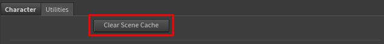

# Performance & Memory

Character Creator characters are detailed, and detailed characters use memory. Here's where the cost comes from and how to keep your sessions fast and lean.

## The fastest fix: import as USD

**USD import mode** sidesteps almost all of this cost, and it's the default. Character Creator's USD export keeps the facial blendshapes sparse, and the tool keeps them sparse **all the way through deformation**, so a heavy HD character imports in **about a second** and a loaded character stays under 8 GB, where the same character costs 20–40 GB via FBX. If performance or memory is a concern, exporting and importing as **USD is the single biggest thing you can do**. See [USD vs FBX](../getting-started/import-modes.md).

The one trade-off: because the sparse path recomputes the facial deformation each frame instead of holding gigabytes of pre-expanded data, scrubbing a very heavy HD character is somewhat slower per frame. On standard characters you won't notice.

The rest of this page applies mainly to **FBX import**, which still has to expand the character on load (and which you'd use for FBX-only features like wrinkles). One thing USD does **not** change is playback memory over long frame ranges. See [Long animations and playback memory](#long-animations-and-playback-memory) below.

## Why the first FBX build is slow

When you import an FBX character, the slow part is Houdini loading and expanding it, particularly its blendshapes (the facial expression targets). A fully-featured CC character has many of these, and expanding them is memory- and time-intensive. This is inherent to how Houdini handles FBX character data, not something specific to this tool. (USD import avoids it, as above.)

The good news: this cost is paid **once**, at build time. After that, adjusting your look on the controller is fast, because the materials just reference the controller. They don't re-cook the character.

!!!info
Expect a heavy or HD character imported **via FBX** to use a substantial amount of RAM once loaded. This is normal for film-quality character data in Houdini. Lighter characters are correspondingly cheaper, and USD import is cheaper across the board.
!!!

## Keeping look-dev fast

While you're working on the look, use these to stay responsive:

* **Quality ▸ Preview** turns off subsurface scattering and uses cheap eyes. It is the single biggest speed-up. (See [The Lookdev Controller](../lookdev/lookdev-controller.md).)
* **Displacement ▸ Disable or Bump**: true displacement is expensive, so use it only for final renders.
* **Hero Eyes off**, for any character whose eyes aren't the focus.

Switch all of these to full quality only when you're ready for final renders.

## Managing memory

### Long animations and playback memory

This one applies to **both USD and FBX**, and is separate from import cost. Once a character is animated, Houdini caches the **deformed mesh for every frame you play or scrub** so playback stays smooth. For a heavy or HD character that's roughly **20 MB per frame**, so a several-hundred-frame range can add **10–20 GB** on top of the character itself, and it grows the more of the range you touch.

USD does **not** avoid this: the per-frame deformed mesh is the same size whichever way you imported, so playing a long animation fills the cache the same. The difference is the baseline it stacks on. In USD mode the character itself only costs a few gigabytes, so even with a full playback cache you stay far below FBX-mode totals.

To keep it under control:

* **Lower Houdini's geometry cache limit** in *Edit ▸ Preferences ▸ Cache*, "Cache Memory (MB)". This is a hard ceiling on exactly this memory; a smaller value trades some scrub smoothness for a lower RAM cap.
* **Play only the range you need.** The cache fills in proportion to the frames you actually visit, so set your playback range to the shot, not the whole clip.
* **Clear Scene Cache** (below) after you're done scrubbing a heavy range.

### Clear Scene Cache

The **Clear Scene Cache** button (in the **Utilities** tab of the Reallusion Rigger node) unloads cached geometry from Houdini's caches to reclaim memory. It is useful after deleting characters or removing animation clips.

!!!warning Geometry that's currently displayed won't unload
Houdini keeps actively-displayed data resident by design. Clear Scene Cache reclaims cooked data that's no longer needed (from deleted characters or removed animations), not the character you're currently looking at. To free a loaded character's memory, delete or bypass its nodes first, then clear the cache.
!!!

## Stash Rig: reopening in seconds

The Rigger has no skin cache. Instead, **Stash Rig** (on by default, in **Character ▸ Build** and on the rig node's **Rig Settings**) stores the built and baked rig, so a reopened scene loads in seconds instead of rebuilding and rebaking it. On a standard FBX character that is about 3 seconds instead of nearly a minute.

It costs hip size: about 220 MB for a standard character, more for a heavy HD one, plus each baked clip. Setting **Stash In** to **External File** and pressing **Save to Disk** keeps the hip small, a few MB, by writing the rig to a file beside it. See [Rig Settings](../using/rig-settings.md).

With Stash Rig off, changing the scene's frame range rebuilds and rebakes the whole rig, which takes about as long as the first build. See [Building the Rig](../using/building-the-rig.md).

## Multiple characters

You can have several characters in one scene. Each gets its own stem-prefixed nodes, its own lookdev controller and its own rig node, so they don't interfere with each other. Just be mindful that each one carries its own memory cost. On a memory-constrained machine, work with one character at a time.
