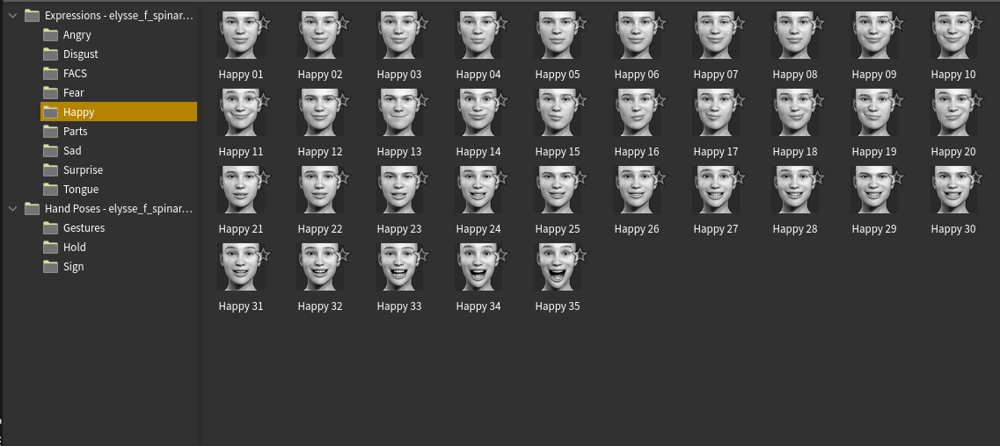
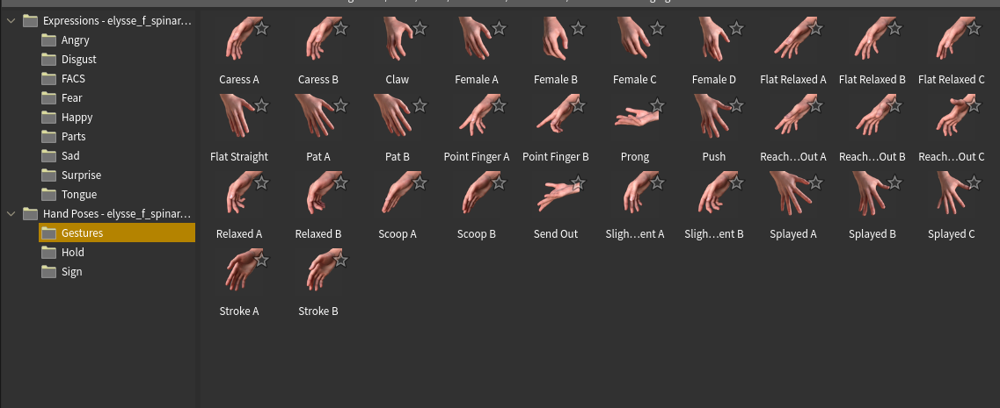
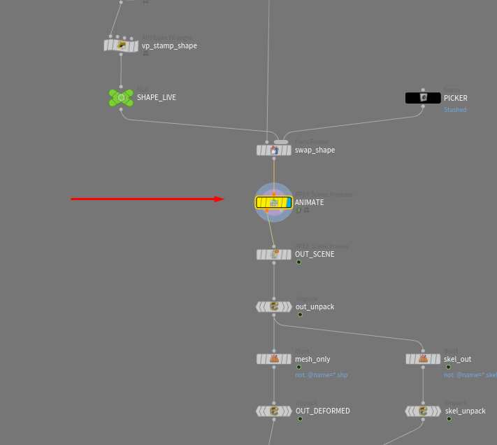

# Animating

Everything on this page happens on the rig node, in Houdini's APEX animate state. If you've animated with APEX before, it's the same state with this character's controls in it; if you haven't, the short version is: pick a control, move it, key it.

## Animate and Exit

**Animate** enters the animate state on the rig, where you pose and key the controls in the viewport. **Exit Animate State** returns you to the normal view.

Your keys don't live on the controls you see. They live on **animation layers** inside the rig node, with the character's own clip at the bottom as **BaseAnimation**. That matters as soon as you want to change a clip rather than replace it, so read [Clips & Layers](clips-and-layers.md) before you start editing the baked animation.

## Controls and gears

The body has IK/FK arms and legs, reverse feet, a spline spine, and FK controls for every finger and toe. Each body part also has a **gear** control holding its settings — IK/FK, stretch, foot roll and the like — and the face has three gears beside the head.

[The Controls](../animate-state/controls.md) names every control and what it moves, and [Gears](../animate-state/gears.md) explains every gear setting. [Getting Around](../animate-state/getting-around.md) covers the animate state's HUD, keys and menus.

  
  
  

## Mirroring a pose

The **Mirror** tool is in the Pose Tools row above the viewport. Clicking it draws a pale preview of the mirrored limb first — that's the live preview, not a failure. Press **Enter** over the viewport to apply it, or Shift+click the Mirror icon for a mirror that applies at once. The opposite control is found by its `L_` / `R_` name.

## The Character Picker

Clicking small controls on a character in the viewport gets old fast, and the picker is the cure. In the animate state, open **New Pane Tab ▸ Animation ▸ APEX Character Picker**. It has **Body**, **Hands**, **Feet** and **Face** tabs, plus **Extras** if the character has joints beyond the standard Character Creator skeleton, such as hair bones. Each tab has a button per control, and clicking one selects that control.

  
  
  
  

The layout the rig ships with is read-only. To arrange your own, add a layout in the pane.

## The Animation Catalog

The rig build fills Houdini's Animation Catalog with **301 expression poses** and **71 hand poses**, taken from Character Creator's own expression and gesture templates, in folders named after the rig. Open an Animation Catalog pane in the animate state to use them.

There are two ways to apply a pose, and they behave differently:

* **With controls selected**, a pose applies only to those controls. This is how you put a hand pose on one hand: select **L Fingers** or **R Fingers** on the picker's **Hands** tab first.
* **With nothing selected**, click the pose's tile and press **Apply** in the panel beside it. It lands on every channel of the active layer: an expression on the face, a hand pose on both hands.

Dropping a pose into the viewport always needs selected controls, for all three options in the drop menu; that's SideFX's rule, and with nothing selected it says "No controls selected". **Add to New Layer** builds its layer from the selected controls too, so select first or you get an empty layer.

A pose writes **one key, at the current frame**. That explains the one thing that surprises everyone: a fist applied over a clip shows on one frame only, because the fingers already carry the clip with a key on every frame and the fist replaces just that one. An expression usually holds across the whole clip, because it lands on the Face Blendshapes gear's channels, which had no other keys, and a single key holds everywhere. To shape that, apply a second expression at another frame and the face blends between the two, apply a neutral one where it should end, or use **Add to New Layer** and set that layer's weight over the frames you want. An expression **adds** onto the clip's own face rather than replacing it.

!!!warning The catalog is not saved with the scene
After reopening a scene, press **Reload Catalog Poses** on the rig node to put this character's poses back.
!!!

## Where your animation lives

Your keys are stored inside the rig node, on its **ANIMATE** node (an APEX Scene Animate node, drawn yellow). **Animate** on the rig node enters the animate state on exactly that node, the keys and layers you make there are stored on it, and they are saved with your scene. The baked clips come into it from the rig above. That's why the build unlocks the rig node, and why deleting the rig node deletes the animation keyed on it.

You never need to go inside to animate. If you do look, leave ANIMATE where it is: everything below it turns your keys into the deformed character that Karma renders.
