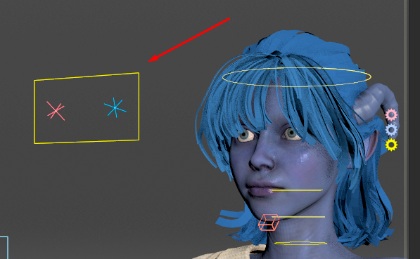

# Auto Animation

Auto Blink and Auto Breathe take care of the two things a character does all the time and an animator never wants to key by hand, and Look At Target keeps the eyes on a camera or an object. All three write ordinary keys, each press on an animation layer of its own, so the result is yours to mute, re-weight, edit or delete like any other layer. All three are in the rig node's **Auto Animation** folder.

## Auto Blink

**Add Auto Blink** keys `face_Eye_Blink_L` and `face_Eye_Blink_R` over the **Frame Range**, on a layer named AutoBlink (then AutoBlink2, and so on). It's one undo step, and it's greyed out on a body-only rig.

* **Profile** uses iClone's own Auto Blink profiles: **Normal**, **Nervous**, **Speechless**, **Charming** and **Child**. They differ in how often the character blinks, how long a blink lasts, and how often blinks come in quick runs.
* **Clip Blinks** decides what happens to blinks already in the animation. **Keep** leaves them, makes an additive layer, and skips any blink that would land right on top of one of the clip's. **Replace** makes an override layer, so inside the Frame Range the eyelids blink only when Auto Blink says so; outside it, the clip's own blinks are untouched.
* **Seed** gives a different pattern with the same profile. To try another, delete the layer, change the Seed and press again.
* **Frame Range** follows the playback range until you type your own. Right-click it and choose **Revert to Defaults** to make it follow the playback range again.

Use **Keep** on a clip whose face already performs (a dialogue take), and **Replace** when the clip's blinks are missing, too regular, or wrong for the shot. To see exactly what was written, make the AutoBlink layer active and press **Show Face Keys**; see [Face Tools](face-tools.md#show-face-keys).

## Auto Breathe

**Add Auto Breathe** keys breathing onto an additive layer named AutoBreathe (then AutoBreathe2, and so on). It moves body controls only, so it needs no facial rig and works on a body-only rig too.

* **Profile:** **Calm** is about 12 breaths a minute and shallow, **Normal** about 16, **Heavy** about 30 and deep with the shoulders lifting, **Sleeping** about 10, slow and deep, from the ribs.
* **Depth** scales the breaths: 1 is the profile as it comes, 2 twice as far. The layer's weight scales them again, and you can key it to make the breathing build or settle.
* **Shoulders**, on by default, lets the clavicles lift the shoulders at each inhale. The arms hold the hands where the clip puts them, so as the shoulders rise the elbows give a little: a couple of millimetres on Normal, around a centimetre on Heavy. On a character whose arms should be still that reads as fidgeting, so turn Shoulders off and the shoulders and elbows are left to the clip.
* **Seed** and **Frame Range** work as they do for Auto Blink.

What moves: the chest control tilts back and lifts a little, the two ribcage controls (`L_RibsTwist`, `R_RibsTwist`) move forward and up, and on Calm, Normal and Heavy the clavicles lift the shoulders, unless **Shoulders** is off. The neck turns back by the chest's tilt, so the head keeps its aim, and the hands stay where the clip holds them. Only whole breaths inside the Frame Range are written, so the layer adds nothing outside them.

## Look At

The eyes can aim at two kinds of target, and the **Look At** slider on the Eyes gear chooses between them.

* **Each eye has its own small cross** in front of it, inside a yellow frame. The crosses ride with the head and normally sit where the clip puts the gaze, so the clip's eye motion lives on them. Animate glances here.
* **The yellow three-ring control**, about a metre in front of the face, stays put in the world. Park it on another character, an object or the camera, and the eyes stay on it whatever the head and body do.

At **0** the crosses stay with the clip and the yellow target does nothing. At **1** the crosses sit on the yellow target, the eyes look at it, and the head and chest turn to help, as much as **Head Weight** and **Body Weight** say. In between, they sit partway. So moving the slider moves the crosses back and forth; that's intended, not a glitch.

Why two targets? They do different jobs, and neither can do both. A target that rides with the head can't steer the head without chasing itself; a target fixed in the world would drag the eyes against every head move. So Look At blends from the first to the second.

### Compared with iClone

iClone has no Look At slider. You turn Look At on by keying a target on the character's Look at Object track, and a transition handle on that key sets how many frames the turn takes. Here, keying **Look At** from 0 to 1 over those frames does the same job. You can see the blend because this rig draws the eye crosses: they slide from where the clip has them onto the yellow target, and halfway through the blend they sit halfway.

The rest of the Eyes gear follows iClone's Look At panel, with 0 to 1 in place of 0 to 100:

| iClone | Eyes gear |
| --- | --- |
| Head Weight, Body Weight | `headWeight`, `bodyWeight` |
| Body Axis Weight X / Y / Z (0 to 200) | `leanX`, `leanY`, `leanZ` (0 to 1) |
| Associated Eyebrow Movement | `browFollow` |
| Enhance CC Characters with Head-Turn Morphs | Always on: the head-turn morphs follow the head |
| None | `angleLimit`, the most the head turns on top of the chest |

iClone's Look at Camera and Look at Object are **Bake Look At Target** here, below.

### Looking at a camera or an object

The **Look At** tab in the rig node's **Auto Animation** folder puts the yellow target on something in your scene for you, at every frame, so the eyes follow it however it moves.

1. Set **Target** to the camera, or to any other object. The eyes aim at its origin. For a SOP node, they aim at the centre of its **Group**; on another character's skeleton, a group such as `@name=Head` picks one joint.
2. Open **Layer Settings** and decide how the head and chest follow the eyes on this layer, or untick its checkbox to leave that to the Eyes gear. The next section explains the difference, and it matters.
3. Set the **Frame Range**, and the **Transition**: the frames the eyes take to turn onto the target at the start and back at the end.
4. Press **Bake Look At Target**.

The yellow target is keyed onto the Target at every frame of the range, and **Look At** is keyed on, on a new layer named LookTarget (then LookTarget2, and so on). Outside the frame range the layer does nothing. It works in the animate state or not, as one undo step.

To look just past a camera's lens rather than into it, set a small **Offset**, such as `0 0.05 0`: it moves the aim point in the Target's own frame.

Nothing stays linked. If the camera or object moves afterwards, or you want different settings, delete the layer in the Animation Layers pane and press the button again.

### Layer Settings or the Eyes gear: which one is in charge

The same five settings exist in two places, and they don't do the same job. This is the part of Look At most likely to confuse you, so here it is in full.

**The Eyes gear's sliders are the live settings.** `headWeight`, `bodyWeight`, `angleLimit`, `browFollow` and `leanX` / `leanY` / `leanZ` on the yellow Eyes gear in the animate state act at every frame, whether you move the yellow target by hand or bake it. They're ordinary channels: key them like any other.

**The Layer Settings on the rig node are not live.** Nothing reads them until you press **Bake Look At Target**. The bake then writes their values as keys onto the new LookTarget layer, on those same gear channels, at every frame of the range, easing in and out over the **Transition** like the target does. LookTarget is an override layer, so inside its range those keys beat whatever the gear holds underneath. Outside the range the gear is in charge again.

Two consequences follow, and both catch people out:

* **Changing a Layer Setting after baking does nothing.** The layer already has its keys. Delete it and bake again.
* **Inside a baked range, moving a gear slider seems to do nothing.** The layer's keys win there. That's the layer doing its job, not a broken slider. Bake again with other settings, or with the checkbox off (below).

**The checkbox on the Layer Settings header decides whether the bake writes the settings at all.** It's on by default.

| Layer Settings checkbox | What the bake keys on the layer | Inside the range, the settings come from |
| --- | --- | --- |
| On (default) | the yellow target, **Look At**, and the five settings | the layer: the gear's sliders are overridden |
| Off | the yellow target and **Look At** only | the Eyes gear's sliders, and any keys you put on them |

When to use which:

* **Leave it on** when each look should keep its own feel. A quick glance at the camera with the head barely moving, then a proper turn toward another character with the chest joining in, are two bakes with two sets of settings, and each layer keeps its own. Where two LookTarget layers overlap, the newer one wins and eases in from the older one's values over its **Transition**.
* **Turn it off** when you'd rather set the settings yourself on the gear: to animate them over one long look (`headWeight` rising as the character commits to the turn, say), or to keep tuning them after the bake and see every change straight away. With the checkbox off, the layer only aims the eyes.

What each setting does, on the gear and in Layer Settings alike:

| Setting | Gear channel | What it does | Default |
| --- | --- | --- | --- |
| **Head Weight** | `headWeight` | How much the head turns toward the target, out of the turn still left once the chest has turned. 0 leaves the head to the animation and the eyes do the looking; 1 points the head straight at the target, up to **Angle Limit**. | 0.6 |
| **Body Weight** | `bodyWeight` | How much the chest turns toward the target, out of the whole turn. 0 leaves the chest to the animation; 1 turns it all the way. The head turns on from wherever the chest ends up. | 0.2 |
| **Angle Limit** | `angleLimit` | The most, in degrees, that the head turns on top of the chest. The chest's turn isn't limited; **Body Weight** alone sets it. The eyes cover whatever the head doesn't. | 70 |
| **Brow Follow** | `browFollow` | Character Creator's eye-to-brow link: the brows rise as the eyes look up and drop as they look down, by this much. 0 is off. | 0 |
| **Lean** | `leanX`, `leanY`, `leanZ` | Scales the chest's turn on each of the character's own axes: X leans forward and back, Y turns left and right, Z tilts to the side. X 0, Y 1, Z 0 turns the chest without leaning or tilting it. | 1, 1, 1 |

!!!info LOP cameras
**Target** takes an object-level camera (`/obj`). A camera that exists only in LOPs has no object to pick: aim the yellow target by hand, or add an object-level camera that follows it.
!!!

### Following a camera live in the animate state

If you animate a camera inside the animate state, the yellow target can follow it live, with Houdini's own constraints instead of a bake:

1. In the viewport's camera menu (top right, **No cam**), choose **New Camera**. It is made where you are looking from, inside the rig node.
2. Turn **Look At** up to 1 on the Eyes gear.
3. In the animate state parameters, **Constraint** tab, set **Constraint** to **Offset**, **Offset** to **None** (so the target sits on the camera rather than keeping its distance) and **Components** to translate only.
4. Select the yellow target, Shift-select the camera's control, and press **H**.

The eyes now follow the camera as you animate it, in the viewport and in the render. The constraint's **Blend** is keyable, and Shift-dragging a frame range on the timeline before pressing **H** limits it to those frames.

Two limits. A camera made this way lives in the animate state only: you can look through it there, but it is not exported to `/stage`, so for the camera you render with, use **Bake Look At Target**. And the character's own hands, arms and head cannot drive the yellow target, because Look At turns the chest and head toward it: Houdini refuses that constraint and the target simply stays where it is.
