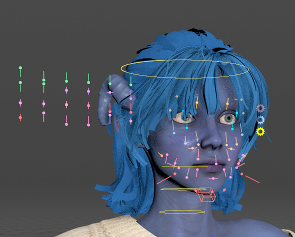
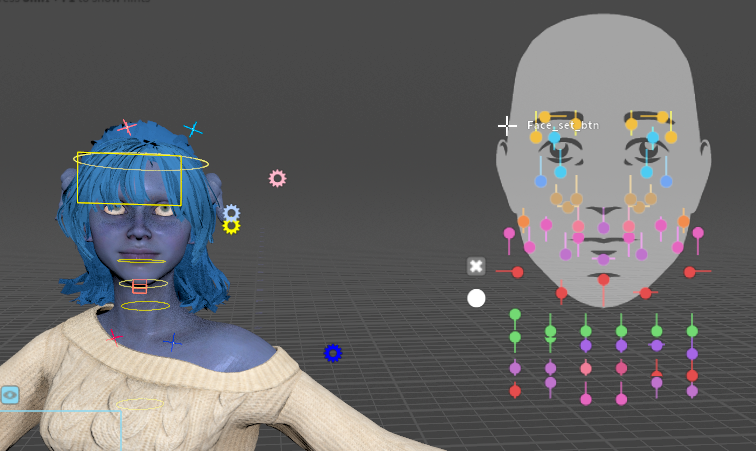
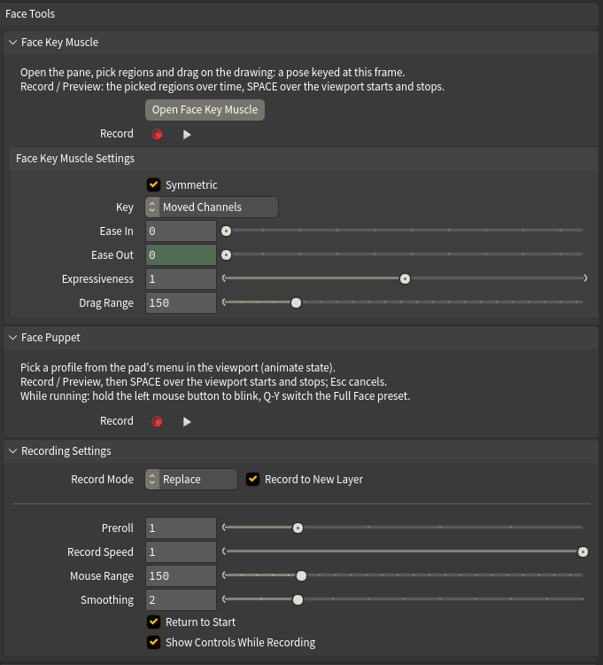
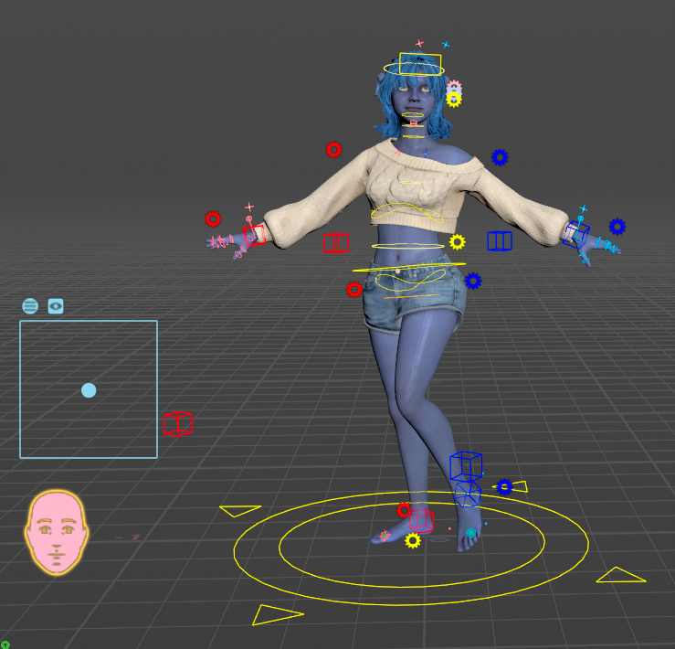

# Face Tools

Every Character Creator morph channel is keyable on the rig as `face_<channel>`, and a clip carries its facial performance along with its body, so playing a clip plays the face too. On top of plain keys, the rig gives you four ways to work on the face: sliders, Face Key Muscle, Face Puppet, and catalog expressions (see [Animating](animating.md#the-animation-catalog)).

The **Face Tools** folder on the rig node is greyed out on a body-only rig (built with **Build Facial Rig** off).

## Sliders and the face board

In the animate state, sliders sit on the face for the brows, blinks, gaze, cheeks, jaw, mouth, tongue and visemes, and a small panel beside the head holds the channels that have no spot on the face. A slider **adds** to the clip's value, so a keyed slider is an offset on top of the performance, not a replacement of it.

The **Face** gear beside the head carries the face's settings. Two you'll use:

* **boxlayout** shows the same sliders as a flat panel locked to the viewport — the **face board** — and hides the ones on the face. It's easier to work with when the head is turned or small on screen. Drag the board by its circle; the X beside the circle turns it off again.
* **mouthControls** shows the lower teeth and tongue FK controls, hidden by default.

The Face gear's set menu (the face sprite at the bottom left of the viewport opens the same list) picks which sliders are shown: **Curated** (the essentials, the default), one region of the face with every channel in it, or **None**.

!!!warning Jaw Open needs the jaw bone
Keying `face_Jaw_Open` to 1 doesn't open the mouth — it can even look more closed. In Character Creator the jaw opens by rotating the jaw bone, and the `Jaw_Open` morph is only the skin correction that goes with that rotation, so on its own it pushes the lips and chin. To open the jaw by curve, key `JawRoot_rx` (the bone), ideally together with `face_Jaw_Open`. The Jaw Open slider and Face Puppet drive both for you.
!!!

The head-turn morphs (`Head_Turn_L/R/Up/Down`, `Head_Tilt_L/R`) reshape the neck as the head moves, and the rig drives them from the head control. So they count as **body** channels: **Clear Body Keys** resets them with the head, and **Clear Face Keys** and **Show Face Keys** leave them alone. Edit them by moving the head.

## A face workflow

The face tools all key the same `face_<channel>` channels, so they combine. One way to use them together:

1. **Start on a layer.** To animate a face over a clip, press **New Layer** in the Face Key Muscle pane. It adds an additive FaceKey layer, so the clip underneath is never touched. To animate from scratch, press **Add Rest Pose Layer** in the **Layers** row and key on that. Every face tool keys the active layer in the [Animation Layers pane](clips-and-layers.md#animation-layers), except Face Puppet and Auto Blink, which make layers of their own.
2. **Block out the big beats** with catalog expressions (in the Animation Catalog pane) or a Face Puppet take: press **Record**, then **SPACE** over the viewport.
3. **Shape the details** with Face Key Muscle. Pick regions and drag. Set **Ease In** and **Ease Out** so each edit blends into the frames around it.
4. **Add life** with Auto Blink, Auto Breathe and Look At (see [Auto Animation](auto-animation.md)).
5. **Check the curves.** Picking regions in Face Key Muscle lists their channels in the Animation Editor. **Show Face Keys** lists every face channel keyed on the active layer.
6. **Undo or start over.** Ctrl+Z undoes any step. Mute or delete a layer in the Animation Layers pane. **Revert to Clip** puts BaseAnimation back to the clip.

## The Face Tools folder

The folder has three collapsible sections. They're all closed by default.

* **Face Key Muscle** has a two-line how-to, the **Open Face Key Muscle** button, a **Record** row (the record dot, plus the play triangle for **Preview**), and the **Face Key Muscle Settings** sub-folder.
* **Face Puppet** has a three-line how-to and its own **Record** row.
* **Recording Settings** is used by both Record rows. **Record Mode** and **Record to New Layer** share one row, followed by **Preroll**, **Record Speed**, **Mouse Range**, **Smoothing**, **Return to Start** and **Show Controls While Recording**.

The next two sections go through Face Key Muscle and Face Puppet. Recording Settings is described under Face Puppet.

## Face Key Muscle

**Face Key Muscle** is Character Creator's Muscle mode for this character: a drawing of the face with a spot for each region, on four tabs, **Full Face**, **Eye**, **Mouth** and **Tongue**. Drag a region and the face follows. Let go and the frame is keyed, as one undo step.

Press **Open Face Key Muscle** to open it. It opens in a pane of its own, floating at first. Dock it like any other Houdini pane.

### Where the keys go

Keys go on the active animation layer. The top of the pane names that layer with its type, its weight and the current frame.

**New Layer** adds an additive layer called FaceKey and makes it the active one. The clip underneath is left untouched. Mute, reweight or delete the layer in the [Animation Layers pane](clips-and-layers.md#animation-layers). Adding the layer is one undo step.

Careful with this one: **New Layer** and posing both need the animate state. Outside it the button is greyed out and the top line of the pane reads "Keys go to: (enter the animate state)". Press **Animate** on the rig node first.

On BaseAnimation with a clip, every frame already has a key. An edit then changes that one frame, unless **Ease In** or **Ease Out** is set. The pane tells you so after the drag.

### Picking regions

* Click a spot to pick it. **Shift** adds to the picks, **Ctrl** removes, and **Ctrl+Shift** toggles, the same as in the viewport.
* Two buttons above the drawing switch between a box and a lasso. With nothing picked, drag on the drawing to pick with whichever one is on. With regions picked, a plain drag poses them instead, so hold **Shift** or **Ctrl** to drag a box.
* Click empty space to pick nothing.
* The picked regions' channels are listed in the Animation Editor, so their curves are in view while you key. Eye and head regions list the eye and head control rotations, and the chin lists the jaw bone.

### Posing

With regions picked, drag anywhere on the drawing, or MMB-drag. The face follows while you drag. **Esc** during a drag cancels it.

A drag starts from what the face shows now. Dragging a lid up first opens the blink that is there, then widens the eye.

Right double-click a spot to reset that region.

### Lip Shape and Split Lips

On the **Mouth** tab, **Lip Shape** chooses which shape the lips spot drives: Funnel, Pucker, Press, Roll Out, Push, Pull, Roll In or Blow. Picking one picks the lips, and the shape's name is shown under the lips spot. **Split Lips** puts the shape on each lip half.

### The Tongue tab

The **Tongue** tab also carries Character Creator's mouth and jaw regions, drawn as rings. You can open the mouth around the tongue without switching tabs.

### Dark spots

A dark spot is a region this character's export carries no shape for. Some characters' pupils are an example. A dark spot moves nothing.

### Reset Picked and Reset Face

**Reset Picked** takes the picked regions back to neutral at this frame, on the active layer. **Reset Face** does the same for the whole face: the shapes, the jaw and the eyes, but not the head.

What neutral means depends on the layer. On an additive layer, the layer stops adding anything there. On BaseAnimation or an override layer, the face goes neutral. **Ease In** and **Ease Out** fade a reset in and out the same way they fade a drag.

Careful with this one: a reset works on the layer's curves, not on a particular earlier drag. At a drag's own frame, with the same Ease values, it cancels that drag. Anywhere else it flattens the face around the playhead.

### Recording the picked regions over time

A drag keys one pose. To perform the movement instead, pick the regions and use the **Record** row in the **Face Key Muscle** section of the Face Tools folder. Put the mouse over the viewport and press **SPACE**. The playbar runs and the mouse moves the picked regions, the way the Face Puppet's pad does. **SPACE** again stops the take, and **Esc** cancels it.

**Preview** (the play triangle) is the same control with nothing keyed, for trying it out. **SPACE** or **Esc** ends it.

The take is a Face Puppet take on the Face Key Muscle entry of the pad's menu, so [Recording Settings](#recording-settings) applies to it. **Mouse Range** sets how far you move the mouse for a full shape. With **Record to New Layer** on, the take lands on a layer called FaceKeyMuscle (a Face Puppet take lands on FacePuppet).

The mouse gives each picked shape a straight line from neutral to its full shape. That means a take doesn't first undo a shape that is already there, the way a drag does. Eye looks, head turns and the head tilt turn bones, so a take leaves them out.

A rig built before this feature needs deleting and building again to get it.

### Settings

These are ordinary Houdini parameters: MMB value ladder, and Ctrl+MMB reverts a value. They sit in the **Face Key Muscle Settings** sub-folder on the rig node. The pane shows the Face Key Muscle section and Recording Settings straight from the rig node.

* **Symmetric**: a picked region brings its other side along. Brows, lids and lips mirror, and the eyes look the same way.
* **Key**: which channels a drag keys at the frame. **Moved Channels** keys only what the drag changed. **Whole Face** holds every face channel the layer has at the frame, which is useful for posing key to key.
* **Ease In** and **Ease Out**: spread each edit over that many frames before and after the current frame, fading out. **Ease Out** follows **Ease In** until you set it on its own, and Ctrl+MMB links it back. With both at 0, an edit keys the current frame only. On a clip that shows on one frame, and a lone key on a fresh layer holds for the whole shot. With one side at 0, the edit starts or ends on the next frame.
* **Expressiveness**: how far a drag can push a shape. 1 is Character Creator's full shape, 2 is twice that. Only what a drag raises is scaled.
* **Drag Range**: the pixels of drag on the drawing for a full shape. Lower is more sensitive.

## Face Puppet

Face Puppet records a facial performance with the mouse, the way iClone's does: you move the mouse, the playbar runs, and the face follows and is keyed.

**The pad** sits bottom-left in the animate state. Its menu sprite, at the pad's top right, picks the **profile**, from Character Creator's own puppet tables: region profiles first (brows, eyes, mouth and so on), then iClone's **Full Face** presets. The sprite beside it picks **Solo**, which limits the parts of the face the profile may move: Brow L/R, Blink L/R, Eye L/R, Eyeball L/R, Nose Tip, Nose L/R, Cheek L/R, Mouth, Jaw, Head Turn, Head Up/Down and Head Tilt. With nothing picked, the profile moves everything it drives. With some picked, the rest of the face keeps what the clip or your keys already had, and a take writes only those parts — solo **Mouth** and **Jaw** on a Full Face profile to puppet just the mouth.

### Recording a take

1. Press **Record** (the red dot) in the **Face Puppet** section of the **Face Tools** folder.
2. Put the mouse over the viewport and press **SPACE**.
3. A red countdown runs the **Preroll** seconds, so you have time to find the motion. Then the playbar plays, with a red frame around the viewport while frames are being recorded, and the mouse drives the pad.
4. **SPACE** again, or the end of the frame range, stops the take. **Esc** cancels it.

While a take runs, hold the left mouse button to close the eyes, and press **Q W E R T Y** to switch to preset 1 to 6 of the current Full Face set. **Preview** (the play triangle), next to **Record**, is the same control with no playbar and no keys, for trying a profile out.

### Where a take goes

**Record Mode** decides what a take does to the animation already there: **Replace** (iClone's default) makes the take the animation of the features it drives, and **Blend** adds it on top.

With **Record to New Layer** on (the default), each take gets a layer of its own — FacePuppet, FacePuppet2 and so on — that you can mute, delete or re-weight without touching the clip, and one undo removes the whole take. Replace makes that layer an override (the take replaces the face over its frames), Blend an additive one. With **Record to New Layer** off, a Replace take overwrites the clip's keys on BaseAnimation.

**Record Mode** and **Record to New Layer** live in **Recording Settings**, not in the Face Puppet section. Face Key Muscle's Record row uses the same two settings, and a Face Key Muscle take goes on a FaceKeyMuscle layer in the same way.

### Recording Settings

**Recording Settings** is a section of the Face Tools folder of its own, closed by default. Both Record rows use it. Besides **Record Mode** and **Record to New Layer**, it holds:

* **Preroll**: the seconds counted down before the take starts, so you can find the motion before it is recorded. The pad already follows the mouse during the countdown.
* **Record Speed**: how fast the playbar runs while recording. 1 is real time, and 0.5 is half speed for a precise performance. Slow it down for a tricky beat. Your playbar settings come back afterwards.
* **Mouse Range**: the pixels of mouse travel, from where you pressed **SPACE**, to a full deflection of the pad (a full shape on a Face Key Muscle take). Lower is more sensitive.
* **Smoothing**: the frames of smoothing on the recorded mouse path. 0 keys exactly as you performed it. A little takes the jitter out of a hand-held performance.
* **Return to Start**: after a take, puts the playhead back on the frame it started from, ready to play it back.
* **Show Controls While Recording**: keeps the rig's controls drawn while a take plays, so you can watch the pad's knob. When it's off, the animate state's own setting applies, which by default hides them during playback.

## Show Face Keys

The Animation Editor lists only the channels of the controls you select, and face morphs belong to no control — so face curves never show up there on their own.

In the animate state, **Show Face Keys** (an icon in the rig node's **Layers** row) lists every face channel with keys on the **active** layer. Edits there play back at once, and Ctrl+Z undoes them. It replaces whatever was pinned, and it goes away when you exit the animate state.

To see only what one tool wrote, make its layer active first. For example, click the **AutoBlink** layer in the Layers tab, then press **Show Face Keys**, and only `face_Eye_Blink_L` and `face_Eye_Blink_R` are listed.
